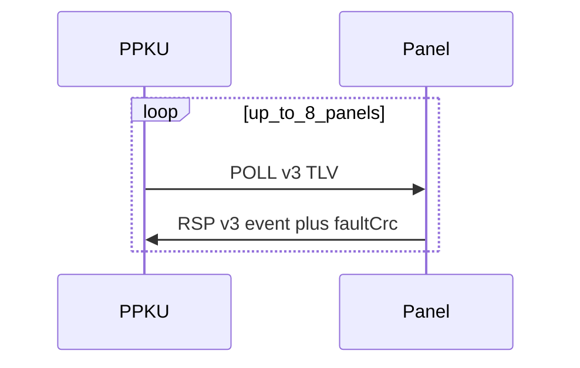

# RS Panel Protocol v3 — описание и бинарный формат

Эталон поведения: **ППКУ1**. Документ соответствует утверждённой архитектуре panel↔ППКУ v3.

Связанный код: [`include/rs_panel_protocol_v3.h`](../include/rs_panel_protocol_v3.h), [`src/rs_panel_protocol_v3.c`](../src/rs_panel_protocol_v3.c).

---

## 1. Роли

| | ППКУ | Панель |
|--|------|--------|
| Истина | зоны/пожары, неисправности, журнал, политика, конфиг | копии списков для UI |
| UI / навигация | — | полная |
| LED / звук | только состояния | правила ППКУ1 + локальные кнопки |
| Hold кнопок | — | локально; вверх — факт/запрос |
| Решение | валидирует события, ACK | одно событие до ACK |

ППКУ **не** шлёт частоты мигания / hold-sound profile (`CMD_LED` blink timing / `CMD_SOUND` hold устаревают для этих сценариев).

---

## 2. Кадр обмена

Команды те же: `POLL=0x01`, `RSP_POLL=0x81`.  
Payload начинается с **`ver = 0x03`**. Иной ver → не v3.



Опрос — с максимальной частотой RS485, master-only.

### 2.1. Семантика одного события

1. Панель занимает слот (`seq != 0`).
2. Пока нет ACK с тем же `seq` — событие повторяется в каждом RSP.
3. ACK с любым result освобождает слот.
4. Одновременно **строго одно** событие на панель.

---

## 3. POLL payload (TLV после ver)

| Tag | Имя | Len | Тело |
|-----|-----|-----|------|
| `0x01` | ACK | u8=2 | `seq u8`, `result u8` (1=OK,2=DENIED,3=IGNORED) |
| `0x02` | SYS | u8=2 | `flags u16le` |
| `0x03` | TIME | u8=6 | h,m,s,d,mon,year(0..99) |
| `0x04` | ZONES | **u16le** | `n u8` + n×(zone,status,rem,name_len,name[]) |
| `0x05` | FAULT_OP | u8 | **deprecated** — текстовые ADD/REMOVE |
| `0x06` | CONFIG | u8=2 | `phase u8`, `percent u8` |
| `0x07` | EVENT_REPLY | **u16le** | `seq,type,result,plen u16le,payload[]` |
| `0x08` | ZONE_NAMES | u8 | `op` CLEAR/ADD; ADD: `zone u8`, `name_len u8`, `name[]` (≤24) |
| `0x09` | DEVICES | u8 | `op` CLEAR/ADD; ADD: MCU record + `n_ch` × (`ch_type`,`ch_l_adr`) |
| `0x0A` | FAULT_EVT | u8 | `op` CLEAR_ALL/SET/CLEAR + тело события (см. коды) |

### SYS flags

| Bit | Имя | Смысл |
|-----|-----|--------|
| 0 | READY | снять «ПРОВЕРКА» |
| 1 | FIRE_ACTIVE | force MAIN, меню запрещено |
| 2 | CONFIG_ACTIVE | force MAIN |
| 3 | HAS_FAULTS | есть неисправности |
| 4 | TIME_VALID | поле TIME осмысленно |
| 5 | POWER_INPUT_FAULT | неисправность входов питания ППКУ (ПИТАНИЕ1/2): панель мигает `LED_POWER` периодом 2 с (как ППКУ1). При 0 и активном v3 — `LED_POWER` постоянно ON. Без связи — OFF. |

### Статусы зоны (ППКУ1 UI)

| Code | Текст |
|------|--------|
| 0 | idle / нет сценария |
| 1 | ДО ПУСКА |
| 2 | ТУШЕНИЕ |
| 3 | ТУШ.ВЫП. |
| 4 | ПОЖАР/ОСТ. |
| 5 | пауза |
| 6 | ПОЖАР1 |
| 7 | ТУШ.ОШ. |
| 8 | ПУСК ЗАБЛ. |
| 9 | ТУШ.ОСТ. |

Зона в событиях: **`0` = все**, `1…N` = CAN/config.

### Каталоги и FAULT_EVT (v3)

**ZONE_NAMES / DEVICES** — поток при init, смене конфига или `RSP.flags.NEED_CATALOG`: CLEAR, затем по одному ADD на POLL.

**FAULT_EVT** — `CLEAR_ALL`, затем `SET` по одному событию на POLL; инкрементальные `SET`/`CLEAR` при изменениях.

Коды неисправностей — `RsPanelV3FaultCode` в [`rs_panel_protocol_v3.h`](../include/rs_panel_protocol_v3.h). Текст UI панель собирает локально по каталогу + коду.

CRC в RSP (раздельные проверки):

| Поле | Смысл | Несовпадение |
|------|--------|--------------|
| `zones_crc` | CRC16 имён активных зон (ZONE_NAMES) | только поток ZONE CLEAR→ADD |
| `devices_crc` | CRC16 записей каталога МКУ (DEVICES) | только поток DEV CLEAR→ADD |
| `faults_crc` | CRC16 нормализованных тел активных FAULT_EVT | CLEAR_ALL→SET |

ППКУ считает ожидаемые CRC из своего конфига; панель отдаёт CRC своего RAM-каталога (после boot — из Flash, если сохранён). Совпадение → rewrite этой части пропускается. `NEED_CATALOG` — только «нет валидного каталога» (virgin / Flash miss).

### FAULT_OP (deprecated)

Текстовый CLEAR/ADD/REMOVE — заменён на FAULT_EVT + каталоги.

---

## 4. RSP payload (фиксированный хвост после ver)

```
ver u8 = 0x03
event.seq u8      /* 0 = нет события */
event.type u8
event.zone u8
event.u8_a u8
event.u16_a u16le
event.u16_b u16le
zones_crc u16le
devices_crc u16le
faults_crc u16le
flags u8   /* bit0 NEED_CATALOG — нет валидного каталога (не частичный CRC) */
```

Минимальная длина RSP v3 с раздельными CRC = **16** байт payload. Старые 14-байтные RSP (без `zones_crc`) декодируются как legacy: `zones_crc=0` → ППКУ перепишет зоны.

### Типы событий панели

| id | Имя | Параметры |
|----|-----|-----------|
| 1 | START_ALL_COMMIT | — |
| 2 | START_SP | zone |
| 3 | STOP_LAUNCH | zone |
| 4 | FIRE_RESET | zone (hold ОСТАНОВ ≥5 с) |
| 5 | SOUND_SET | u8_a = on |
| 6 | WIFI_SET | u8_a = on |
| 7 | JOURNAL_COUNT | — |
| 8 | JOURNAL_GET | u16_a = index |
| 9 | JOURNAL_GET_N | u16_a = index, u16_b = n |
| 10 | ZONE_BLOCK_LIST | — |
| 11 | ZONE_BLOCK_SET | zone, u8_a = blocked |
| 12 | DEVICES_COUNT | — |
| 13 | DEVICES_GET | u16_a = index |
| 14 | DEVICES_GET_N | u16_a, u16_b |
| 15 | EXT_CAN_SET | u8_a = on |

Ответ данных — в POLL `EVENT_REPLY` (+ ACK).

---

## 5. Ready / «ПРОВЕРКА»

Пока `SYS.READY=0` — по центру **ПРОВЕРКА**. Панель **не** решает конец проверки
сама (кроме локальной «НЕТ СВЯЗИ»): ждёт флаг `SYS_READY` в POLL от ППКУ.

### Когда ППКУ ставит `SYS_READY`

ППКУ выставляет `SYS_READY` только когда `Warning_IsProcessDelayActive()==0`, т.е.
после стартовой паузы `warning_process_delay` (~10 с в `app.cpp`). С этого же
момента вызывается `WarningProcess1ms` → `CommitFaultSnapshot` / выгрузка
неисправностей на панели. Так UI после «ПРОВЕРКА» сразу получает корректный
НОРМА или АВАРИЯ, без краткого ложного НОРМА.

Исторически в заголовке был таймер `RS_PANEL_V3_SYS_READY_DELAY_MS` (20 с =
CM grace + POSITION + запас; ошибочно ужимали до 300 мс). Константа убрана:
ready привязан к реальному пайплайну warning, а не к отдельному magic delay.

Время RTC в POLL: первый кадр как можно раньше (в т.ч. во время стрима каталога);
далее ~ каждые **10 с** (`RS_PANEL_V3_TIME_SYNC_PERIOD_MS`); панель тикает секунды локально.

---

## 6. Поведение UI (кратко)

- **Пожар** → MAIN, меню запрещено (`FIRE_ACTIVE`).
- **Новая неисправность** → MAIN; меню разрешено.
- **Конфиг** стартует только на ППКУ; панель — WiFi/ext CAN; POLL несёт percent → success/fail (звук); затем обычный MAIN (норма/неисправности).
- Таймер зоны локальный; смена фазы только после нового статуса в ZONES.
- Тест индикации — только локально на панели.

---

## 7. Фазы внедрения в прошивках

1. Каркас encode/decode + ACK/event + READY/ПРОВЕРКА + TIME  
2. ZONES + FAULT_OP/CRC + локальные кнопки/hold/LED/звук  
3. Меню: журнал / блок / связь / диспетчер  
4. CONFIG push + отключение устаревших CMD_LED/SOUND hold-путей  

Прошивать **ППКУ2 и панель** парой версий с v3 POLL.
